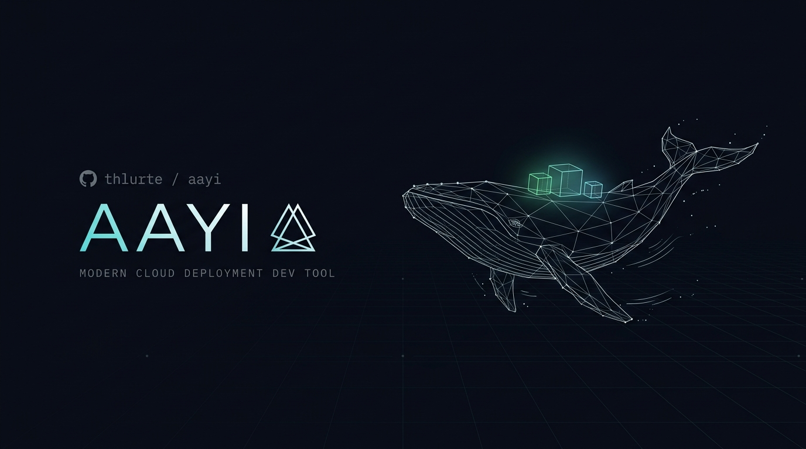

<p align="center">
  
</p>

<h1 align="center">Aayi</h1>

<p align="center">
  <strong>Deploy Docker apps to any server with zero downtime and automatic HTTPS.</strong>
</p>

<p align="center">
  <a href="https://pypi.org/project/aayi/"></a>
  <a href="https://pypi.org/project/aayi/"></a>
  <a href="https://github.com/thlurte/aayi/actions/workflows/ci.yml"></a>
  <a href="https://github.com/thlurte/aayi/releases"></a>
  <a href="https://github.com/thlurte/aayi/stargazers"></a>
  <a href="https://github.com/thlurte/aayi/blob/main/LICENSE"></a>
</p>

<p align="center">
  <a href="#quickstart">Quickstart</a> &bull;
  <a href="#features">Features</a> &bull;
  <a href="#why-aayi-vs-kamal">Why Aayi vs. Kamal?</a> &bull;
  <a href="#command-reference">Commands</a> &bull;
  <a href="#architecture">Architecture</a>
</p>

---

## Features

- **Zero-Downtime Container Swaps**: Seamlessly switches traffic between revisions via Caddy's dynamic in-memory Admin API (`:2019`) with active health checks.
- **Automatic HTTPS**: TLS certificates via Let's Encrypt / ZeroSSL managed automatically by Caddy without external cert-bot scripts.
- **Docker Compose & Multi-Container**: Deploy multi-service setups directly from `docker-compose.yml` or multi-service `deploy.yml`.
- **Public vs. Private Containers**:
  - **Public**: Dedicated subdomains per service (`app.example.com`, `api.example.com`) with automatic TLS.
  - **Private**: Background workers, redis, databases on isolated internal network `aayi-net` with zero exposed host ports.
- **Concurrent SSH Execution**: Asynchronous, parallel multi-server deployment fleet powered by AsyncSSH.
- **Type-Safe Declarative Config**: Strict validation of `config/deploy.yml` with friendly Pydantic error diagnostics and `${ENV_VAR:-default}` substitution.
- **Remote Builds Without Registry**: Build directly on remote servers using in-memory tar stream (`--remote-build`) without needing Docker Hub or AWS ECR.
- **Instant Rollback**: Revert traffic to previous healthy container in milliseconds with `aayi rollback`.
- **Stateful Accessories**: Spin up databases (PostgreSQL, MySQL, Redis) with persistent Docker volumes and loopback host protection.

---

## Why Aayi vs. Kamal?

| Feature | Kamal | Aayi |
| :--- | :--- | :--- |
| **Runtime & Dependencies** | Ruby & Bundler | Python 3.13+ or standalone binary (0 dependencies) |
| **Reverse Proxy** | Traefik / Kamal Proxy | **Caddy** (In-memory API reload, zero drop connections, automatic TLS) |
| **Multi-Service / Compose** | Separate configs / accessories | **First-class multi-service** & `docker-compose.yml` conversion |
| **Ephemeral Remote Build** | Requires Docker Registry | **Optional `--remote-build`** (streams code archive directly over SSH) |
| **Target Fleet Concurrency** | SSHKit threads | **AsyncSSH** event loop (lightweight, non-blocking) |
| **Configuration Engine** | ERB YAML templates | **Pydantic v2 Models** with strict schema checks |

---

## Architecture

```
                                 [ CLI: aayi ]
                               (Typer + Rich UI)
                                       │
                              [ Config: deploy.yml ]
                               (Pydantic v2 Models)
                                       │
                      ┌────────────────┴────────────────┐
                      ▼                                 ▼
             [ Local Builder ]                 [ AsyncSSH Fleet ]
           (docker buildx push)             (Parallel Multi-Server Pool)
                                                        │
                              ┌─────────────────────────┴─────────────────────────┐
                              ▼                                                   ▼
                       [ Web Server(s) ]                                   [ Worker Server(s) ]
                     ┌───────────────────┐                               ┌────────────────────┐
                     │ Caddy (Port 80/443│                               │ Worker Container   │
                     │  Admin API :2019) │                               └────────────────────┘
                     └─────────┬─────────┘
                               │ (Dynamic Route)
                     ┌─────────┴─────────┐
                     │ App Container     │
                     │ (Port: 8000/8001) │
                     └───────────────────┘
```

---

## Quickstart

### 1. Installation

**One-line standalone installer (Zero dependencies, no Python or pip needed):**
```bash
curl -fsSL https://raw.githubusercontent.com/thlurte/aayi/main/install.sh | bash
```

**Or run instantly with uvx (no installation required):**
```bash
uvx aayi --help
```

**Or install via uv tool or pip:**
```bash
uv tool install aayi
# or
pip install aayi
```

### 2. Initialize Your Project

Generate starter `config/deploy.yml` and an optimized multi-stage `Dockerfile`:
```bash
aayi init
```

### 3. Configure `config/deploy.yml`

```yaml
service: myapp
image: your-docker-user/myapp

servers:
  web:
    - 192.168.1.10
  workers:
    - 192.168.1.11
  user: root

registry:
  server: docker.io
  username: your-docker-user
  password: ${DOCKER_REGISTRY_PASSWORD}

proxy:
  domain: app.example.com
  app_port: 8000
  healthcheck_path: /healthz
  drain_timeout: 10
  tls: true
  email: admin@example.com

env:
  clear:
    PORT: "8000"
    ENVIRONMENT: production
  secret:
    - SECRET_KEY
    - DATABASE_URL
```

### 4. Setup Target Servers

Ensures official Docker CE and Caddy are running on all target hosts:
```bash
aayi setup
```

### 5. Deploy with Zero Downtime

Builds the image with `docker buildx`, pushes to your registry, boots a new container, runs health checks, and smoothly switches Caddy upstream traffic:
```bash
aayi deploy
```

> **Tip:** Don't want to use an external Docker registry? Deploy directly to remote servers via in-memory tar streaming:
> ```bash
> aayi deploy --remote-build
> ```

---

## Command Reference

| Command | Description |
| :--- | :--- |
| `aayi init` | Scaffolds `config/deploy.yml`, `Dockerfile`, and `.dockerignore`. |
| `aayi setup` | Installs Docker CE (if missing) and boots Caddy reverse proxy on all hosts. |
| `aayi deploy` | Full zero-downtime deployment (build, push, boot, healthcheck, swap Caddy traffic). |
| `aayi redeploy` | Redeploy an existing image tag on remote servers without rebuilding locally. |
| `aayi rollback` | Atomically revert Caddy upstream to the previous healthy container. |
| `aayi logs` | Real-time multi-host unified log streaming with colored host labels. |
| `aayi exec <cmd>` | Execute an ad-hoc command or interactive shell inside running container. |
| `aayi proxy status` | Inspect current live Caddy routing state and upstreams. |
| `aayi proxy reload` | Force Caddy to route traffic to a specific container port. |
| `aayi accessory boot <name>` | Start an accessory (e.g. Postgres, Redis) with persistent volumes. |
| `aayi accessory stop <name>` | Stop an accessory container. |
| `aayi accessory logs <name>` | View or follow logs for an accessory container. |
| `aayi compose convert` | Convert an existing `docker-compose.yml` to native `config/deploy.yml`. |
| `aayi ci init` | Generates `.github/workflows/deploy.yml` for automated GitHub Actions CI/CD. |
| `aayi version` | Display current installed version of Aayi. |

---

## Contributing & Development

```bash
# Clone the repository
git clone https://github.com/thlurte/aayi.git
cd aayi

# Sync virtual environment & dependencies
uv sync

# Run tests
uv run pytest -v
```

---

## License

MIT
